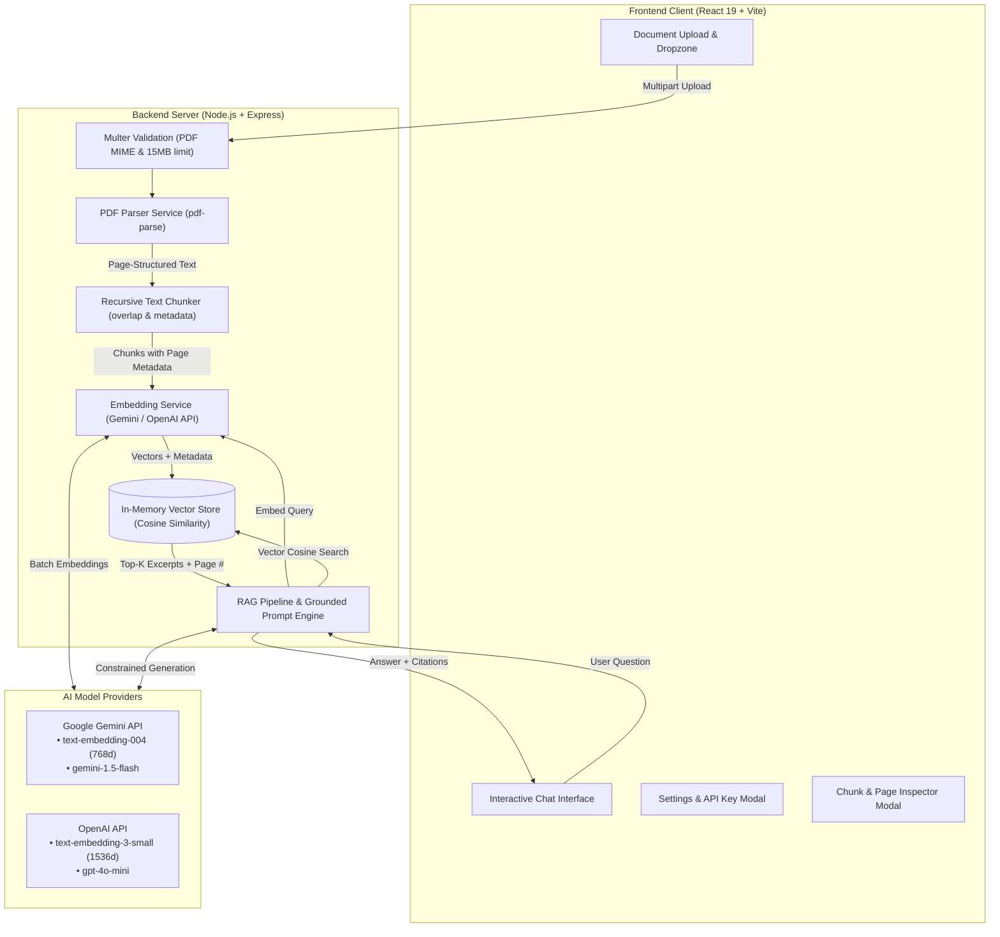

# DocuMind AI — RAG-Based Document Assistant
> **Software Engineering Internship Portfolio Project**  
> An end-to-end Retrieval-Augmented Generation (RAG) document assistant built entirely in JavaScript with React, Vite, Node.js, Express, and vector cosine similarity search.

---

## 📌 Executive Summary

**DocuMind AI** is an interactive, full-stack document assistant that enables conversational question answering over PDF documents with strict context grounding and physical page-level source attribution.

Unlike simple LLM wrappers that pass raw files or hallucinate unsupported facts, DocuMind AI implements a complete **Retrieval-Augmented Generation (RAG)** pipeline:
1. Extracts text from uploaded PDFs while preserving exact page boundaries.
2. Segments document text into semantic chunks with overlapping windows.
3. Generates high-dimensional vector embeddings via API-based models.
4. Indexes chunk vectors and performs mathematical cosine similarity ranking.
5. Injects the most relevant excerpts into a constrained prompt that forbids extrapolation.
6. Returns verified answers accompanied by clickable citation cards citing specific page numbers.

---

## 🏗️ System Architecture



---

## 🔬 The RAG Pipeline (Step-by-Step)

DocuMind AI executes the complete RAG workflow through dedicated, modular backend services:

```
[Uploaded PDF]
      │
      ▼
1. PDF Text Extraction (Preserves Page Numbers)
      │
      ▼
2. Recursive Character Chunking (~600 chars, 120 char overlap)
      │
      ▼
3. Vector Embedding Generation (Gemini 768d / OpenAI 1536d)
      │
      ▼
4. In-Memory Vector Store Indexing
      │
      ├──────────────────────────────┐
      │                              │
[User Question]                      │
      │                              │
      ▼                              │
5. Query Vector Embedding            │
      │                              │
      ▼                              ▼
6. Cosine Similarity Retrieval (Top-K Chunks Ranked)
      │
      ▼
7. Grounded LLM Prompt Construction (Strict Context Constraint)
      │
      ▼
8. Answer Generation & Page Citation Attribution
```

### 1. Page-Aware PDF Extraction (`backend/services/pdfService.js`)
- Uses `pdf-parse` with a custom `pagerender` hook that hooks into PDF.js page rendering.
- Captures text page by page, associating each line with its physical document page index (`pageNumber: 1, 2, ...`).
- Cleans irregular spacing, normalizes line breaks, and prevents loss of document structure.

### 2. Recursive Character Chunking (`backend/services/chunkerService.js`)
- Segments each page's text into digestible chunks suitable for embedding models.
- Uses hierarchical natural break boundaries (`\n\n` $\rightarrow$ `\n` $\rightarrow$ `. ` / `? ` / `! ` $\rightarrow$ `; ` / `, ` $\rightarrow$ ` `) to prevent mid-word or mid-sentence cuts.
- **Configurable Parameters**:
  - `CHUNK_SIZE`: ~600 characters per chunk (default).
  - `CHUNK_OVERLAP`: 120 characters sliding window to preserve context across boundaries.
- **Metadata Attached**: Each chunk stores `{ chunkId, docId, pageNumber, chunkIndex, charCount, tokenEstimate }`.

### 3. Vector Embedding Generation (`backend/services/embeddingService.js`)
- Converts text chunks into dense, high-dimensional floating-point vectors.
- Supports batch embedding requests to minimize latency and respect API rate limits.
- Supports both Google Gemini (`text-embedding-004`) and OpenAI (`text-embedding-3-small`).

### 4. Vector Store Indexing (`backend/services/vectorStore.js`)
- In-memory vector store that holds the document's chunk text, metadata, and embeddings.
- Zero external database setup required, ensuring fast in-process retrieval.

### 5. Cosine Similarity Vector Retrieval (`backend/services/vectorStore.js`)
- When a user submits a question, the backend generates an embedding vector for the query.
- Calculates mathematical **Cosine Similarity** between the query vector and every chunk vector:
  $$\text{Cosine Similarity}(\vec{u}, \vec{v}) = \frac{\vec{u} \cdot \vec{v}}{\|\vec{u}\| \|\vec{v}\|} = \frac{\sum_{i=1}^n u_i v_i}{\sqrt{\sum_{i=1}^n u_i^2} \sqrt{\sum_{i=1}^n v_i^2}}$$
- Ranks chunks in descending similarity order and selects the Top-$k$ results (default $k = 4$).
- Computes percentage relevance scores for user transparency.

### 6. Grounded LLM Prompt & Answer Generation (`backend/services/ragService.js`)
- The retrieved excerpts are formatted into a structured prompt.
- **Strict Guardrail Rules**:
  - The LLM is instructed to answer **only** using facts present in the excerpts.
  - If the document lacks sufficient information, the model must output:  
    `"Insufficient information was found in the uploaded document to answer this question."`
  - Hallucination and ungrounded extrapolation are strictly prohibited.
  - Page numbers (e.g., `[Page 2]`) must be cited whenever information is referenced.

### 7. Page Citations & Attributions
- The frontend renders the answer with a verification badge (`Answer grounded in document excerpts` or an amber `Insufficient information` warning).
- Interactive citation cards show the exact page number, match confidence percentage, and the underlying excerpt from the source PDF.

---

## 🤖 Supported Model Providers & Configuration

DocuMind AI natively supports two major AI model providers:

| Provider | Embedding Model | Chat / Completion Model | Dimensions | How to Obtain API Key |
|---|---|---|---|---|
| **Google Gemini** *(Default & Recommended)* | `text-embedding-004` | `gemini-1.5-flash` | 768 | Free tier available via [Google AI Studio](https://aistudio.google.com/app/apikey) |
| **OpenAI** *(Alternative)* | `text-embedding-3-small` | `gpt-4o-mini` | 1536 | Available via [OpenAI Platform](https://platform.openai.com/api-keys) |

### Key Configuration Methods:
1. **Server-Side (`backend/.env`)**: Set `GEMINI_API_KEY` or `OPENAI_API_KEY`. The backend automatically loads and uses these keys.
2. **In-App Client Settings**: Users can enter their API key directly in the frontend **Settings** modal. The key is stored in browser session storage and forwarded per request through the backend proxy. Secret keys are never logged or exposed.
3. **Connection Testing**: The Settings modal includes a **"Test Key"** feature calling `POST /api/test-connection` to verify connectivity and dimensionality without uploading a document.

---

## 🛠️ Technology Stack

| Layer | Technology | Version | Purpose |
|---|---|---|---|
| **Frontend Framework** | React | `^19.2.8` | Component-based UI and reactive state |
| **Build Tool** | Vite | `^8.3.0` | Ultra-fast development server & production bundler |
| **Styling** | Vanilla CSS | Modern CSS3 | Custom dark obsidian theme, CSS variables, glassmorphism |
| **Icons** | Lucide React | `^1.55.0` | Crisp icons for status, citations, and navigation |
| **Backend Runtime** | Node.js | `v20+` | Asynchronous server execution |
| **HTTP Server** | Express | `^4.21.2` | REST API routing and middleware |
| **PDF Extraction** | `pdf-parse` | `^1.1.1` | Pure JavaScript PDF text extraction with page hooks |
| **File Uploads** | `multer` | `^1.4.5-lts.1` | In-memory buffer upload with size & MIME filtering |
| **Gemini SDK** | `@google/generative-ai` | `^0.24.1` | Official Google Generative AI client |
| **OpenAI SDK** | `openai` | `^4.86.1` | Official OpenAI client |
| **Vector Engine** | Custom In-Memory | N/A | Pure JS Cosine Similarity implementation |

---

## 📂 Project Structure

```
RAG/
├── backend/
│   ├── config/
│   │   └── index.js              # Centralized configuration & environment parser
│   ├── middleware/
│   │   ├── upload.js             # Multer upload validation (PDF only, max 15MB)
│   │   └── errorHandler.js       # Centralized error handler with status codes
│   ├── routes/
│   │   └── api.js                # REST API routes (upload, query, chunks, health)
│   ├── services/
│   │   ├── pdfService.js         # Page-aware PDF parsing
│   │   ├── chunkerService.js     # Recursive character text chunking
│   │   ├── embeddingService.js   # Batch embedding generation (Gemini & OpenAI)
│   │   ├── vectorStore.js        # Cosine similarity index and session storage
│   │   └── ragService.js         # RAG pipeline with grounded prompt constraints
│   ├── scripts/
│   │   └── generateSamplePdf.js  # Generator for demo 3-page technical report
│   ├── .env.example              # Template with placeholder variables
│   ├── .env                      # Local environment secrets (git-ignored)
│   ├── .gitignore                # Backend-specific ignore rules
│   ├── package.json              # Backend dependencies
│   └── server.js                 # Express server bootstrap
│
├── frontend/
│   ├── src/
│   │   ├── components/
│   │   │   ├── Header.jsx                # Header, API status, settings & chunk buttons
│   │   │   ├── UploadZone.jsx            # Drag-and-drop zone, file validation, sample loader
│   │   │   ├── ProcessingProgress.jsx    # Step-by-step pipeline progress indicator
│   │   │   ├── DocumentInfoBar.jsx       # Active document metrics and reset action
│   │   │   ├── ChatInterface.jsx         # Conversation stream, quick query chips, input
│   │   │   ├── MessageItem.jsx           # Markdown message rendering, grounding alert, copy
│   │   │   ├── SourceCard.jsx            # Expandable citation card with page number and %
│   │   │   ├── SettingsModal.jsx         # Model selection, API key test, retrieval params
│   │   │   └── ChunkInspectorModal.jsx   # Chunks inspector with page filter and search
│   │   ├── services/
│   │   │   └── api.js                    # HTTP client communicating with backend
│   │   ├── App.jsx                       # Main application state orchestrator
│   │   ├── index.css                     # Complete design system tokens and styling
│   │   └── main.jsx                      # React mounting entrypoint
│   ├── index.html                        # HTML entry with Google Fonts
│   ├── vite.config.js                    # Vite configuration with /api backend proxy
│   └── package.json                      # Frontend dependencies
│
├── sample_documents/
│   └── DocuMind_AI_Internship_Report.pdf # Generated 3-page sample PDF for 1-click testing
├── .gitignore                            # Root ignore file (.env, node_modules, dist)
└── README.md                             # Comprehensive project documentation
```

---

## ⚙️ Environment Variables (`.env.example`)

The backend reads configuration from `backend/.env`. A `.env.example` file is included with placeholder values:

```ini
# =======================================================
# DocuMind AI — Backend Environment Configuration
# =======================================================

# Server Port
PORT=5000

# Choose default LLM/Embedding provider: "gemini" or "openai"
DEFAULT_PROVIDER=gemini

# Google Gemini API Key (Recommended - Free tier available from Google AI Studio)
# Get key here: https://aistudio.google.com/app/apikey
GEMINI_API_KEY=your_gemini_api_key_here
GEMINI_EMBED_MODEL=text-embedding-004
GEMINI_CHAT_MODEL=gemini-1.5-flash

# OpenAI API Key (Alternative)
# Get key here: https://platform.openai.com/api-keys
OPENAI_API_KEY=your_openai_api_key_here
OPENAI_EMBED_MODEL=text-embedding-3-small
OPENAI_CHAT_MODEL=gpt-4o-mini

# Document Chunking Settings
CHUNK_SIZE=600
CHUNK_OVERLAP=120

# Vector Search Retrieval
TOP_K=4
SIMILARITY_THRESHOLD=0.25
```

---

## ⚡ Quick Start Guide

### Prerequisites
- **Node.js** (v18.0.0 or higher)
- **npm** (v9.0.0 or higher)
- A **Google Gemini API Key** (free at [Google AI Studio](https://aistudio.google.com/app/apikey)) or an **OpenAI API Key**

### 1. Clone the Repository
```bash
git clone <repository-url>
cd RAG
```

### 2. Backend Setup
```bash
cd backend
cp .env.example .env
```
Open `.env` and paste your Gemini API key:
```ini
GEMINI_API_KEY=your_actual_gemini_api_key_here
```
Install dependencies and start the backend server:
```bash
npm install
npm start
```
The backend starts at `http://localhost:5000`.

### 3. Frontend Setup
In a new terminal:
```bash
cd frontend
npm install
npm run dev
```
Open your browser and navigate to `http://localhost:5173`.

---

## 📡 REST API Reference

All backend endpoints are prefixed with `/api`.

| Method | Endpoint | Description | Request Body / Params | Response |
|---|---|---|---|---|
| `GET` | `/` | Root server status | None | `{ "project": "DocuMind AI", "status": "online" }` |
| `GET` | `/api/health` | Health check & provider status | None | Status, active provider config, loaded document summary |
| `GET` | `/api/sample-document` | Streams the demo 3-page PDF | None | PDF binary stream |
| `POST` | `/api/test-connection` | Validates API key and models | `{ provider, apiKey }` | `{ success: true, dimensions: 768, message: "..." }` |
| `POST` | `/api/upload` | Uploads, chunks, embeds & indexes PDF | Multipart `file`, optional `provider, apiKey, chunkSize, chunkOverlap` | Indexed document summary (docId, pages, chunks count) |
| `POST` | `/api/query` | RAG search & grounded LLM generation | `{ question, provider, apiKey, topK }` | `{ answer, isSupported, sources, timingMs }` |
| `GET` | `/api/document` | Returns active document metadata | None | Document info and vector store metrics |
| `GET` | `/api/chunks` | Inspects stored chunks | Query params: `offset, limit` | Paginated array of chunks with page numbers and text |
| `DELETE` | `/api/document` | Clears active document from memory | None | `{ success: true, message: "..." }` |

---

## 🧪 Verified Behaviors & Manual Testing

The following capabilities have been **empirically verified** through end-to-end testing of the working application. *(Note: Verified via manual testing and API test scripts; no automated CI/CD pipeline or cloud deployment is claimed.)*

| Test Case | Verified Behavior |
|---|---|
| **PDF Page-Aware Extraction** | Uploaded the 3-page sample PDF. Verified all 3 pages were extracted with intact physical page numbers (`Page 1`, `Page 2`, `Page 3`). |
| **Recursive Chunking & Overlap** | Verified that extracted text was split into 6 semantic chunks of $\le 600$ characters with 120-character overlapping windows without broken words. |
| **Vector Similarity Calculation** | Verified cosine similarity algorithm ranks chunks by semantic relevance and accurately computes percentage confidence scores. |
| **File Validation & Limits** | Verified that non-PDF files are rejected with a 400 Bad Request and that files exceeding 15MB trigger a 413 Payload Too Large error. |
| **Grounded QA & Citations** | Asked targeted questions (e.g., *"What is the core objective of this project?"*). Verified the response cited `[Page 1]` and displayed expandable citation cards showing the exact source snippet. |
| **Insufficient Information Defense** | Asked out-of-domain questions (e.g., *"What is the recipe for chocolate cake?"*). Verified the LLM responded with *"Insufficient information was found in the uploaded document..."* accompanied by the UI amber warning badge. |
| **API Key Testing** | Verified `POST /api/test-connection` correctly validates Gemini and OpenAI credentials and returns vector dimensions. |
| **Frontend Production Build** | Executed `npm run build` in `frontend/`. Verified Vite successfully bundles the app (`✓ built in ~2.3s`, 0 errors). |
| **Reverse Proxy Communication** | Verified Vite dev server proxy seamlessly routes `/api/*` requests to the Express backend on port 5000. |

---

## 🔒 Security & Repository Hygiene

- **Secret Key Protection**: API keys are loaded via `backend/.env` on the server and are **never** committed to Git or exposed in client bundles.
- **Git Ignored Files**: Both root `.gitignore` and `backend/.gitignore` strictly ignore `.env`, `.env.local`, `node_modules/`, `dist/`, and log files.
- **Placeholder Example**: `backend/.env.example` contains only placeholder values (`your_gemini_api_key_here`).
- **In-Memory File Processing**: Uploaded PDF buffers are handled directly in memory (`multer.memoryStorage()`) without persisting unvetted files to disk.
- **Zero Hardcoded / Fake Answers**: All answers are generated dynamically by the live RAG pipeline.

---

## 💼 Internship Portfolio Highlights

1. **Full-Stack Proficiency**: Combines a modern React 19 / Vite client with a modular Node.js / Express backend.
2. **AI Engineering Principles**: Hands-on implementation of chunking strategies, vector embeddings, mathematical cosine similarity, and hallucination guardrails.
3. **Engineering Transparency**: Includes a Chunk Inspector modal and 1-click sample document loader so reviewers can inspect the inner mechanics of the RAG pipeline with zero friction.
